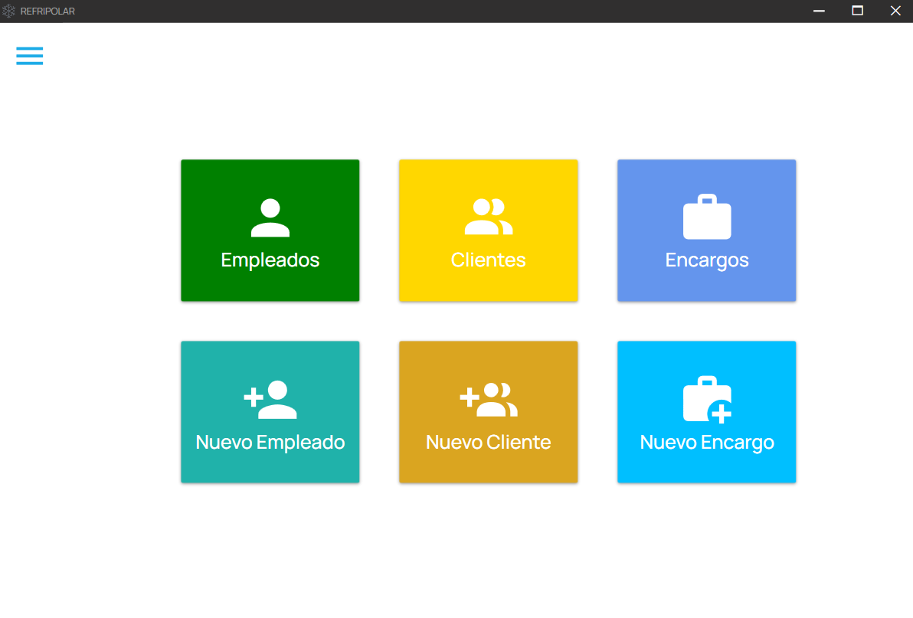
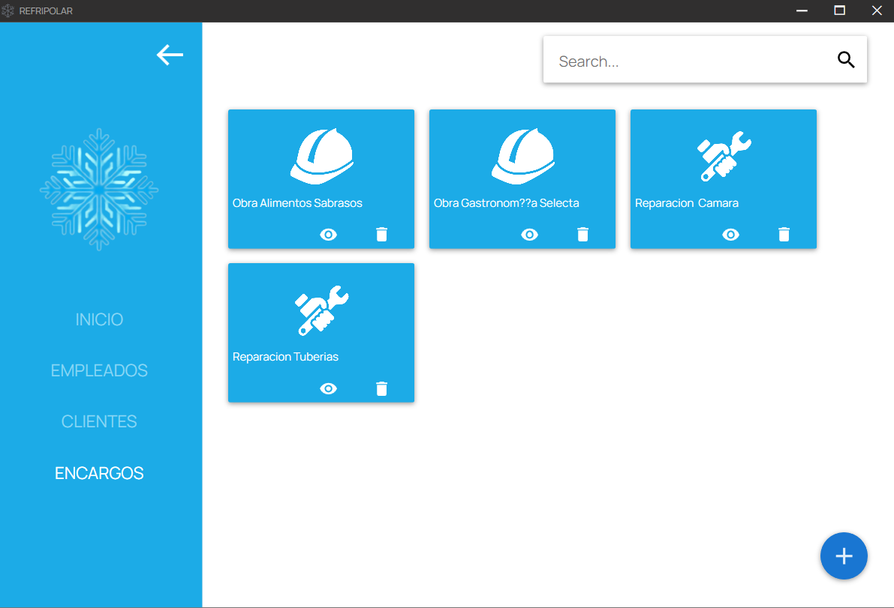
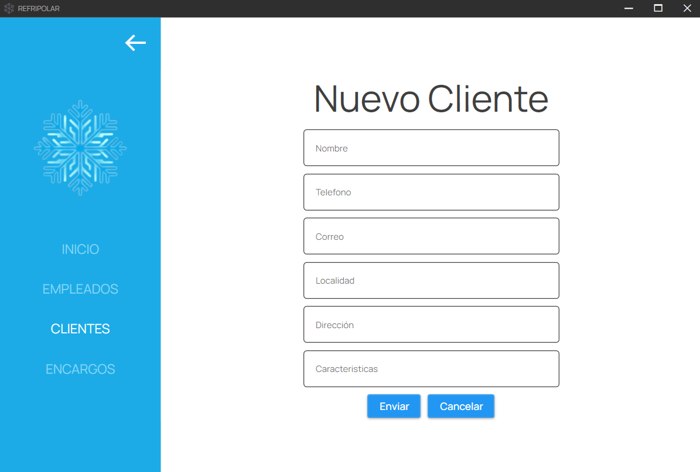

# RefriPolar Desktop

Aplicación de escritorio (**WPF · .NET**) para la gestión interna de *RefriPolar*, una empresa ficticia de refrigeración industrial: empleados, clientes y encargos (obras y reparaciones). Consume la API REST [**refripolar-api**](https://github.com/AdrianColomoMoragues/refripolar-api). Proyecto desarrollado en el ciclo de **Desarrollo de Aplicaciones Multiplataforma (DAM)**.


<p align="center">
  
</p>

## Funcionalidades

- **Empleados**: listado, ficha, alta, edición y baja, con foto, categoría profesional, antigüedad y reconocimiento médico.
- **Clientes**: listado, consulta, alta, edición y baja.
- **Encargos**: obras y reparaciones con cliente, encargado, prioridad, porcentaje de avance y asignación de empleados.
- **Validación de formularios**: email, teléfono, código postal, porcentajes y campos obligatorios.
- **Fotos de empleados** almacenadas en Azure Blob Storage.

## Capturas

| Encargos | Alta de cliente |
|:---:|:---:|
|  |  |

## Stack

| Capa | Tecnología |
|------|------------|
| UI | WPF + MaterialDesignThemes |
| Arquitectura | MVVM con CommunityToolkit.Mvvm (mensajería y comandos) |
| Acceso a datos | RestSharp + Newtonsoft.Json contra la API REST |
| Imágenes | Azure Blob Storage |

## Ejecutarla

Requisitos: Windows, **Visual Studio 2022** (carga de trabajo *Desarrollo de escritorio de .NET*) y el SDK de **.NET 6** o superior.

1. Abre `ProyectoRefriPolar.sln`.
2. Pulsa **F5**.

Por defecto la aplicación usa la **API de demostración** publicada en Render:

```
https://refripolar-api.onrender.com/apirefripolar/data/
```

> La API está en un plan gratuito: si lleva un rato sin uso, la primera carga puede tardar alrededor de un minuto. Si no responde a tiempo, la aplicación muestra un aviso en lugar de cerrarse.

### Usar la API en local

Arranca la API con Docker (`docker compose up` en el repo [refripolar-api](https://github.com/AdrianColomoMoragues/refripolar-api)) y cambia el ajuste `endpoint` en `ProyectoRefriPolar/App.config`:

```xml
<value>http://localhost:8080/apirefripolar/data/</value>
```

### Subida de fotos (opcional)

La cadena de conexión de Azure Storage **no está en el código**. Para poder subir fotos nuevas, defínela como variable de entorno y reinicia Visual Studio:

```powershell
setx REFRIPOLAR_AZURE_STORAGE "DefaultEndpointsProtocol=https;AccountName=...;AccountKey=...;EndpointSuffix=core.windows.net"
```

Sin ella la aplicación funciona igual: las fotos existentes se siguen viendo y solo se desactiva la subida.

## Estructura

```
ProyectoRefriPolar/
├── Model/          Entidades (Empleados, Clientes, Encargos, CategoriaProfesional)
├── View/           Ventanas, páginas de consulta/edición y formularios (XAML)
├── ViewModel/      Lógica de presentación (MVVM)
├── Services/       ApiClient (HTTP compartido) y servicios por recurso + Azure
├── Validaciones/   Reglas de validación de los formularios
├── Converters/     Conversores de datos para el binding
└── mensajeria/     Mensajes entre ViewModels (WeakReferenceMessenger)
SetupRefriPolar/    Proyecto de instalador (Visual Studio Installer Projects)
```

## Proyectos relacionados

- [refripolar-api](https://github.com/AdrianColomoMoragues/refripolar-api): API REST (Jakarta EE + JPA + MySQL) que usa esta aplicación · [demo](https://refripolar-api.onrender.com/apirefripolar/)

---

Todos los datos de ejemplo (personas, empresas, correos) son ficticios.
